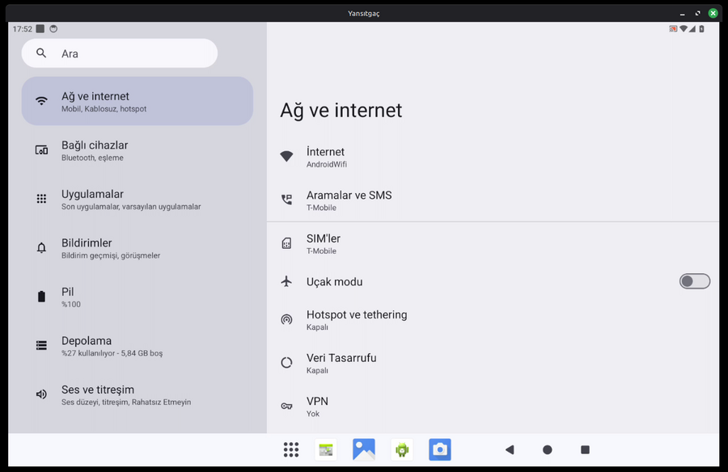
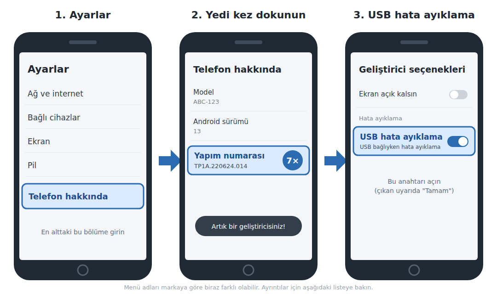
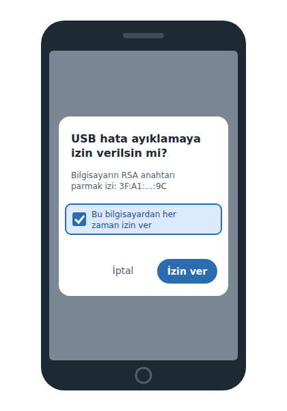
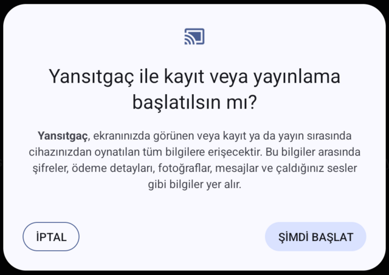

# Yansıtgaç

Android telefonunuzun veya tabletinizin ekranını ve sesini **USB kablosuyla** akıllı tahtaya ya da bilgisayara yansıtır.

- Kurulum gerektirmez, yönetici (root) şifresi istemez. İndirip çalıştırmanız yeterli.
- İnternet veya kablosuz ağ gerekmez; görüntü yalnızca kablo üzerinden gider.
- Tablet döndürüldüğünde görüntü de kendiliğinden döner.
- ETAP (Pardus) yüklü akıllı tahtalar için hazırlanmıştır, diğer Linux dağıtımlarında da çalışır.



---

## Hangi dosyayı indirmeliyim?

Dosyaları [Sürümler (Releases) sayfasından](../../releases/latest) indirebilirsiniz.

| Tahtanızdaki sistem | İndirilecek dosya |
|---|---|
| ETAP 23, Pardus 23 ve daha yeni | `Yansitgac-x86_64.AppImage` |
| ETAP 21, Pardus 21 | `Yansitgac-ETAP21-x86_64.AppImage` |

Hangisi olduğundan emin değilseniz **ETAP21** dosyasını indirin; o, yeni sürümlerde de çalışır.

---

## İlk kullanım

Aşağıdaki adımlar yalnızca **ilk seferde** gereklidir.

### 1. Telefonda "USB hata ayıklama"yı açın

Bu ayar, telefonun bilgisayarla görüntü paylaşabilmesi için gereklidir. Bir kez açmanız yeterlidir.



1. Telefonda **Ayarlar**'ı açın ve en alttaki **Telefon hakkında** (tablette **Tablet hakkında**) bölümüne girin.
2. **Yapım numarası** yazısına art arda **7 kez** dokunun. Telefon kilit şifrenizi sorabilir. "Artık bir geliştiricisiniz!" yazısı çıkınca bu adım tamamdır.
3. Ayarlar'a geri dönün. **Sistem** bölümünün içinde (bazı telefonlarda doğrudan Ayarlar'ın en altında) **Geliştirici seçenekleri** belirir. Buraya girin ve **USB hata ayıklama** anahtarını açın. Çıkan uyarıya **Tamam** deyin.

**Markaya göre "Yapım numarası"nın yeri:**

| Marka | Yapım numarası | Geliştirici seçenekleri |
|---|---|---|
| Samsung | Ayarlar → Telefon bilgileri → Yazılım bilgileri → **Yapım numarası** | Ayarlar'ın en altında |
| Xiaomi, Redmi, POCO | Ayarlar → Telefon hakkında → **MIUI sürümü** (yeni modellerde **OS sürümü**) | Ayarlar → Ek ayarlar |
| Huawei, Honor | Ayarlar → Telefon hakkında → **Yapım numarası** | Ayarlar → Sistem ve güncellemeler |
| Diğerleri (General Mobile, Lenovo, Oppo, TCL vb.) | Ayarlar → Telefon/Tablet hakkında → **Yapım numarası** | Ayarlar → Sistem |

**Xiaomi, Redmi ve POCO kullanıyorsanız:** Geliştirici seçenekleri içinde **USB üzerinden yükle** ayarını da açın. Bu ayar kapalıysa program, gereken uygulamayı telefona kuramaz.

### 2. Programı çalıştırılabilir yapın

İndirdiğiniz dosyaya sağ tıklayın, **Özellikler → İzinler** bölümüne gidin ve **"Programın çalıştırılmasına izin ver"** kutusunu işaretleyin. Sonra dosyaya çift tıklayarak açın.

### 3. Telefonu USB kablosuyla bağlayın

1. Telefonda **"USB hata ayıklamaya izin verilsin mi?"** sorusu çıkar. **"Bu bilgisayardan her zaman izin ver"** kutusunu işaretleyip **İzin ver**'e dokunun.

   

2. Program, telefona **Yansıtgaç** adlı küçük bir uygulamayı kendiliğinden kurar. Bu birkaç saniye sürer. Uygulamayı ayrıca indirmeniz gerekmez.

3. Bazı telefonlarda (özellikle Xiaomi, Redmi ve POCO) **"Yansıtgaç uygulamasının ses kaydetmesine izin verilsin mi?"** sorusu çıkar. Sesin bilgisayara aktarılabilmesi için **Uygulamayı kullanırken**'e dokunun. Bu soru yalnızca bir kez sorulur.

4. Telefonda **"Yansıtgaç ile kayıt veya yayınlama başlatılsın mı?"** sorusu çıkar. **Şimdi başlat**'a dokunun.

   

Telefonunuzun ekranı artık bilgisayarda görünür.

---

## Her gün kullanım

1. Programı açın.
2. Telefonu USB kablosuyla takın.
3. Telefonda **Şimdi başlat**'a dokunun.

Yansıtmayı bitirmek için kabloyu çıkarın ya da telefonun bildirim alanındaki **Yansıtgaç** bildiriminden **Durdur**'a dokunun.

### Klavye kısayolları

| Tuş | İşlevi |
|---|---|
| **F11** veya pencereye **çift tıklama** | Tam ekran |
| **Esc** | Tam ekrandan çık |
| **M** | Sesi kapat / aç |

---

## Ses hakkında

- Yansıtma sırasında ses **yalnızca bilgisayardan** gelir: telefonun sesi kendiliğinden kısılır, yansıtma bitince geri açılır. Telefondan da duymak isterseniz telefonun ses açma tuşuna basmanız yeterlidir.
- Ses aktarımı için telefonda **Android 10 veya daha yeni** bir sürüm gerekir. Daha eski telefonlarda yalnızca görüntü aktarılır; pencerenin başlığında "ses yok" yazar.
- Bazı uygulamalar (örneğin bazı müzik ve dizi uygulamaları) seslerinin aktarılmasına izin vermez. Bu uygulamalarda görüntü gelir, ses gelmez; sesi telefondan duymak için telefonun ses açma tuşuna basın.
- Telefon görüşmelerinin sesi aktarılmaz.

---

## Sorun mu yaşıyorsunuz?

**Program "Telefon bekleniyor" yazısında kalıyor**
- Kablonun veri aktarabilen bir kablo olduğundan emin olun. Bazı kablolar yalnızca şarj içindir.
- Telefonda USB hata ayıklamanın açık olduğunu kontrol edin (yukarıdaki 1. adım).
- Tahtanın başka bir USB girişini deneyin.

**"Bu bilgisayar telefona USB üzerinden erişemiyor" yazıyor**
- Telefonun bildirim alanını aşağı çekin, USB bildirimine dokunun ve **Dosya aktarımı** seçeneğini seçin. Sonra kabloyu çıkarıp yeniden takın.

**"USB hata ayıklamaya izin verilsin mi?" sorusu çıkmıyor**
- Kabloyu çıkarıp yeniden takın. Telefonun ekran kilidinin açık olduğundan emin olun.

**"Uygulama telefona kurulamadı" yazıyor**
- Xiaomi, Redmi veya POCO kullanıyorsanız Geliştirici seçeneklerinden **USB üzerinden yükle**'yi açın.

**Görüntü var ama ses yok**
- Pencere başlığına bakın: "ses kapalı" yazıyorsa **M** tuşuna basın.
- "ses yok" yazıyorsa telefonunuzun Android sürümü sesi desteklemiyordur.
- Sesi açtığınız uygulama, sesinin aktarılmasına izin vermiyor olabilir.
- Telefonda ses izni reddedildiyse: telefonda **Ayarlar → Uygulamalar → Yansıtgaç → İzinler → Mikrofon** bölümünden **Uygulamayı kullanırken**'i seçin.

**Program hiç açılmıyor**
- Dosyayı çalıştırılabilir yaptığınızdan emin olun (yukarıdaki 2. adım).
- Doğru dosyayı indirdiğinizden emin olun. ETAP 21 kullanıyorsanız `ETAP21` yazan dosyayı indirin.

---

## Gizlilik

- Görüntü ve ses yalnızca USB kablosu üzerinden aktarılır. Hiçbir şey internete gönderilmez.
- Telefona kurulan **Yansıtgaç** uygulamasını istediğiniz zaman telefonun ayarlarından kaldırabilirsiniz. Programı tekrar kullandığınızda yeniden kurulur.

---

## Geliştiriciler için

Program C++ ve GTK2 ile, telefon uygulaması Java ile yazılmıştır. AppImage paketlerini üretmek için:

```bash
./scripts/appimage-yap.sh hepsi
```

Bu komut paketleri `dist/` klasörüne üretir. Derleme podman ile Debian 11/12 konteynerlerinde yapılır; ayrıca Android SDK ve JDK 17+ gerekir. Telefon ile bilgisayar arasındaki bağlantının ayrıntıları [docs/protokol.md](docs/protokol.md) dosyasındadır.

## Lisans

Yansıtgaç, [GNU Genel Kamu Lisansı sürüm 3](LICENSE) (GPL-3.0) ile dağıtılır.

Paketlerin içinde şu bileşenler de bulunur:

- [FFmpeg](https://ffmpeg.org): yalnızca H.264 çözücü ve görüntü dönüştürme bölümleri, LGPL-2.1 veya sonrası.
- [Android SDK Platform Araçları](https://developer.android.com/tools/releases/platform-tools) içindeki `adb`: Apache 2.0.
- ETAP 21/23 sistemlerinde bulunmayabilecek GTK2 kütüphaneleri: LGPL.
